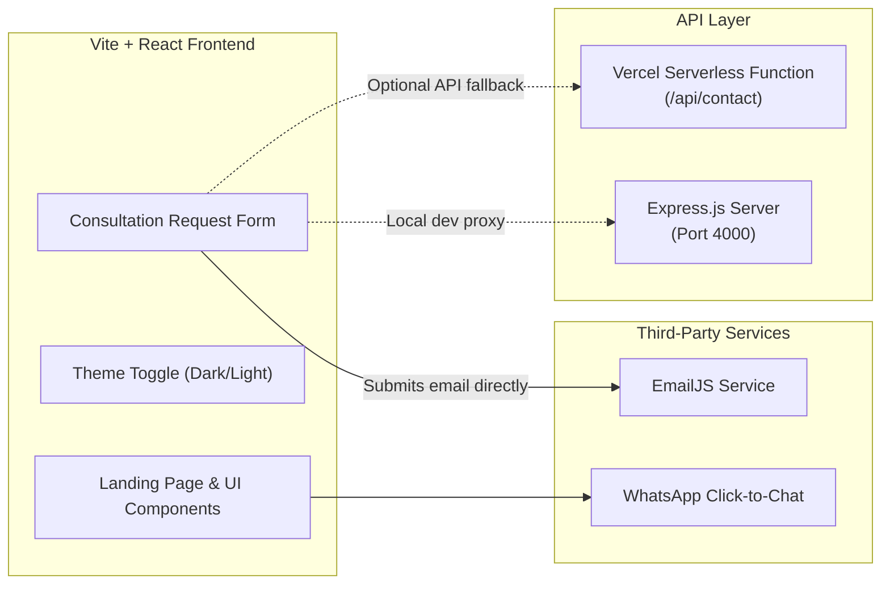

# ⚡ ZeroThree Solutions — AI & Engineering Agency Portfolio

[](https://zero-threesolutions.vercel.app/)
[](https://react.dev/)
[](https://www.typescriptlang.org/)
[](https://vitejs.dev/)
[](https://nodejs.org/)

ZeroThree Solutions is an enterprise-grade AI agency and software engineering portfolio. Designed with a dark, futuristic SaaS aesthetic, glassmorphism UI accents, fluid micro-interactions, and high-conversion client intake flows.

🌐 **Production URL:** [https://zero-threesolutions.vercel.app/](https://zero-threesolutions.vercel.app/)  
📦 **GitHub Repository:** [https://github.com/zero333three-cyber/portfolio-Agency](https://github.com/zero333three-cyber/portfolio-Agency)

---

## 📑 Table of Contents

- [Overview & Architecture](#-overview--architecture)
- [Key Features](#-key-features)
- [Tech Stack](#-tech-stack)
- [Repository Structure](#-repository-structure)
- [Environment Variables (.env)](#-environment-variables-env)
- [Getting Started Locally](#-getting-started-locally)
- [Available Scripts](#-available-scripts)
- [EmailJS Integration Guide](#-emailjs-integration-guide)
- [Backend & Serverless API](#-backend--serverless-api)
- [Vercel Deployment Guide](#-vercel-deployment-guide)
- [Contact & Support](#-contact--support)

---

## 🏛️ Overview & Architecture

The application is structured as an npm workspaces monorepo accommodating two deployment patterns:

1. **Serverless Deployment (Default for Vercel):**  
   The client is built with Vite and hosted as a static Single Page Application (SPA). The contact form is dispatched directly via **EmailJS** on the client side, while serverless functions located in `client/api/contact.js` provide an automated fallback endpoint.

2. **Full-Stack Monolith (Node.js + Express):**  
   The workspace includes an Express backend in `server/` that can serve both the REST API on `/api/contact` and the compiled static client assets in `client/dist`.



---

## ✨ Key Features

- **Futuristic Dark & Light Modes:** Smooth CSS variable transitions with persistent theme preference stored in `localStorage`.
- **High-Impact Hero & Floating Visuals:** Modern 3D isometric floating elements, backdrop blur, ambient neon glows, and interactive call-to-actions.
- **Service Capability Catalog:** Highlighted technical proficiencies across:
  - 🤖 **AI Automation** (Zapier, LangChain, n8n, Python, Airtable)
  - 🧠 **Autonomous AI Agents** (OpenAI, FastAPI, TypeScript, Node.js)
  - 📊 **Data Analytics & BI** (PostgreSQL, Power BI, Excel, Interactive Charts)
  - 🌐 **Modern Full-Stack Engineering** (React, Next.js, Docker, Kubernetes, AWS)
- **Interactive Project Portfolio:** Showcase cards with high-resolution previews, technical stack chips, and architectural summaries.
- **Lead Intake & Consultation Form:**
  - Automated transactional email delivery through **EmailJS**.
  - Local resilient fallback (`localStorage`) ensuring no lead data is lost in case of network anomalies.
  - Interactive animated confirmation & error modals with direct WhatsApp escalations.
- **Floating WhatsApp CTA:** Pulsing floating action button configured for immediate client consultation.
- **Responsive Layout:** Pixel-perfect across ultra-wide monitors, laptops, tablets, and smartphones.

---

## 💻 Tech Stack

### Frontend (`client/`)
- **Core:** [React 18.3](https://react.dev/), [TypeScript 5.7](https://www.typescriptlang.org/)
- **Bundler & Tooling:** [Vite 5.4](https://vitejs.dev/)
- **Animations:** [Framer Motion 10](https://www.framer.com/motion/)
- **Icons:** [React Icons](https://react-icons.github.io/react-icons/) (Feather Icons, Simple Icons, FontAwesome)
- **Forms & Email:** [@emailjs/browser](https://www.emailjs.com/)

### Backend & API (`server/` & `api/`)
- **Server:** [Express 4.18](https://expressjs.com/), [Node.js](https://nodejs.org/) (v18+)
- **Middleware:** [CORS](https://www.npmjs.com/package/cors)
- **Serverless:** Vercel Node Serverless Functions (`api/contact.js`)

---

## 📂 Repository Structure

```
portfolio-Agency/
├── .env.example              # Unified environment variable template
├── .gitignore                # Git ignore rules (node_modules, .env, dist)
├── package.json              # Monorepo root workspace config & scripts
├── package-lock.json         # Pinned dependency tree
├── README.md                 # Detailed project documentation
│
├── api/                      # Root Vercel Serverless Function
│   └── contact.js            # Standalone contact POST endpoint handler
│
├── client/                   # Frontend React + TypeScript application
│   ├── .env                  # Local client environment variables (git-ignored)
│   ├── .env.example          # Client env template
│   ├── index.html            # HTML entry point with metadata & SEO tags
│   ├── package.json          # Frontend dependencies & build scripts
│   ├── tsconfig.json         # TypeScript compiler configuration
│   ├── vite.config.ts        # Vite configuration (proxy to :4000)
│   │
│   ├── api/                  # Vercel function when Root Directory = client
│   │   └── contact.js        # Serverless API fallback
│   │
│   ├── public/               # Static assets & media
│   │   ├── favicon.ico
│   │   ├── logo.png          # Agency brand identity logo
│   │   └── projects/         # Project case study preview images
│   │
│   └── src/                  # Application source code
│       ├── App.tsx           # Primary application container & sections
│       ├── index.css         # Global styles, CSS design tokens & animations
│       ├── main.tsx          # React DOM root entry
│       ├── vite-env.d.ts     # TypeScript declarations for Vite & env vars
│       └── components/       # Reusable React components
│           ├── AnimatedIcon.tsx
│           ├── CustomSelect.tsx
│           └── ThemeToggle.tsx
│
└── server/                   # Backend Express application
    ├── .env                  # Local server environment variables (git-ignored)
    ├── .env.example          # Server env template
    ├── index.js              # Express server setup, CORS & /api/contact route
    └── package.json          # Server dependencies (Express, CORS, Nodemon)
```

---

## 🔐 Environment Variables (.env)

The application uses environment variables to configure client-side third-party services and backend parameters.

### 1. Client Variables (`client/.env`)

> **Note:** In Vite, variables exposed to the frontend browser bundle **must** start with `VITE_`.

| Variable Name | Required | Default Value | Description |
| :--- | :---: | :--- | :--- |
| `VITE_EMAILJS_SERVICE_ID` | **Yes** | `service_gvdjnwh` | EmailJS Service ID connected to your sending email address. |
| `VITE_EMAILJS_TEMPLATE_ID` | **Yes** | `template_7s5tgup` | EmailJS Template ID defining email layout & subject. |
| `VITE_EMAILJS_PUBLIC_KEY` | **Yes** | `cx2UTKoC3FzQ3CPL-` | EmailJS Public API Key (Account Public Key). |
| `VITE_WHATSAPP_NUMBER` | **Yes** | `919703320989` | WhatsApp number in international format (digits only). |
| `VITE_CONTACT_EMAIL` | **Yes** | `zero333three@gmail.com` | Primary agency contact email displayed on the UI. |
| `VITE_CONTACT_EMAIL_SECONDARY` | **Yes** | `zerothreesolutions@gmail.com` | Secondary agency contact email displayed on the UI. |
| `VITE_CONTACT_PHONE` | **Yes** | `+91 9703320989` | Primary telephone number formatted with country code. |
| `VITE_API_URL` | No | _Empty (relative proxy)_ | Base URL if directing API requests to a separate remote server. |

### 2. Server Variables (`server/.env`)

| Variable Name | Required | Default Value | Description |
| :--- | :---: | :--- | :--- |
| `PORT` | No | `4000` | Port on which the Express server listens. |
| `NODE_ENV` | No | `development` | Runtime mode (`development` or `production`). |
| `CLIENT_ORIGIN` | No | `http://localhost:5173` | Allowed origin for CORS requests. |

---

## 🚀 Getting Started Locally

### Prerequisites
- [Node.js](https://nodejs.org/) v18.0.0 or higher
- [npm](https://www.npmjs.com/) v9.0.0 or higher

### Step 1: Clone the Repository
```bash
git clone https://github.com/zero333three-cyber/portfolio-Agency.git
cd portfolio-Agency
```

### Step 2: Install Dependencies
Run `npm install` in the project root to install dependencies for both the root workspace, `client`, and `server`:
```bash
npm install
```

### Step 3: Setup Environment Files
Copy the example environment files:
```bash
# In the client folder
cp client/.env.example client/.env

# In the server folder (if running the Express backend)
cp server/.env.example server/.env
```

### Step 4: Run the Development Server

**Option A — Run Both Frontend & Backend Concurrently (Recommended):**
```bash
npm run dev
```
- Client runs at: [http://localhost:5173](http://localhost:5173)
- Express API runs at: [http://localhost:4000](http://localhost:4000)

**Option B — Run Frontend Only:**
```bash
npm run client
```

**Option C — Run Backend Only:**
```bash
npm run server
```

---

## 🛠️ Available Scripts

From the repository root, you can execute:

| Command | Action |
| :--- | :--- |
| `npm run dev` | Runs both Express server and Vite development client concurrently. |
| `npm run client` | Starts the Vite development server on port `5173`. |
| `npm run server` | Starts the Express server with `nodemon` live-reloading on port `4000`. |
| `npm run build` | Compiles TypeScript and builds the production bundle in `client/dist`. |
| `npm start` | Runs the production Express server (`node server/index.js`). |

---

## 📧 EmailJS Integration Guide

The contact consultation form on the website directly dispatches notifications via EmailJS.

To link your own EmailJS account:

1. **Sign Up / Log In:** Go to [EmailJS](https://www.emailjs.com/) and open your dashboard.
2. **Add an Email Service:**
   - Navigate to **Email Services** > **Add New Service**.
   - Choose your provider (e.g. Gmail, Outlook) and connect your account.
   - Copy your **Service ID** (e.g., `service_gvdjnwh`).
3. **Create an Email Template:**
   - Navigate to **Email Templates** > **Create New Template**.
   - Use the following variables in your template:
     - `{{name}}`: The client's full name.
     - `{{time}}`: Timestamp of submission (formatted in IST).
     - `{{message}}`: Contains the detailed message body including client email, company, project type, and budget.
   - Save the template and copy your **Template ID** (e.g., `template_7s5tgup`).
4. **Retrieve Public Key:**
   - Go to **Account** > **API Keys**.
   - Copy your **Public Key** (e.g., `cx2UTKoC3FzQ3CPL-`).
5. **Update Variables:**
   - Add these values to `client/.env` locally and in your Vercel project environment variables.

---

## 🌐 Backend & Serverless API

### Endpoint: `POST /api/contact`

Receives client consultation and project inquiries.

#### Request Headers
```http
Content-Type: application/json
```

#### Request Payload
```json
{
  "name": "Alex Mercer",
  "email": "alex@enterprise.ai",
  "company": "Enterprise AI Labs",
  "projectType": "AI Automation",
  "budget": "$5,000 - $10,000",
  "message": "We would like to automate our internal reporting workflows."
}
```

#### Success Response (`200 OK`)
```json
{
  "status": "success",
  "message": "Your request has been received. We will connect with you shortly!"
}
```

#### Validation Error (`400 Bad Request`)
```json
{
  "error": "Please fill in the required fields (Name, Email, Message)."
}
```

---

## ☁️ Vercel Deployment Guide

The repository is configured for automated deployments with Vercel.

### Project Settings on Vercel
- **Framework Preset:** `Vite`
- **Root Directory:** `client`
- **Build Command:** `npm run build` (or `tsc && vite build`)
- **Output Directory:** `dist`

### Setting Environment Variables in Vercel

All required frontend variables have been synced to Vercel:

```bash
VITE_EMAILJS_SERVICE_ID=service_gvdjnwh
VITE_EMAILJS_TEMPLATE_ID=template_7s5tgup
VITE_EMAILJS_PUBLIC_KEY=cx2UTKoC3FzQ3CPL-
VITE_WHATSAPP_NUMBER=919703320989
VITE_CONTACT_EMAIL=zero333three@gmail.com
VITE_CONTACT_EMAIL_SECONDARY=zerothreesolutions@gmail.com
VITE_CONTACT_PHONE=+91 9703320989
```

#### Via Vercel Web Dashboard:
1. Go to your project at [vercel.com](https://vercel.com).
2. Navigate to **Settings** > **Environment Variables**.
3. Add the key-value pairs selecting **Production**, **Preview**, and **Development** targets.
4. Redeploy to apply changes.

---

## 📞 Contact & Support

- **Agency:** ZeroThree Solutions
- **Website:** [https://zero-threesolutions.vercel.app](https://zero-threesolutions.vercel.app)
- **Primary Email:** [zero333three@gmail.com](mailto:zero333three@gmail.com)
- **Secondary Email:** [zerothreesolutions@gmail.com](mailto:zerothreesolutions@gmail.com)
- **WhatsApp:** [+91 9703320989](https://wa.me/919703320989)
- **GitHub:** [@zero333three-cyber](https://github.com/zero333three-cyber)

---

&copy; ZeroThree Solutions. All rights reserved.
